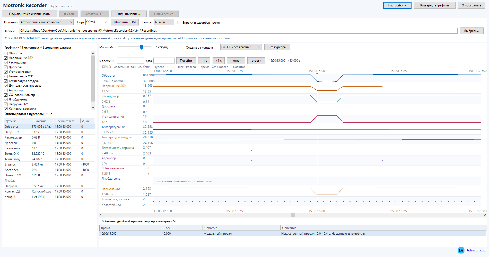

# Motronic Recorder by leitoauto.com

**Версия 0.2.4** · Windows · Bosch Motronic M1.5 · VAG-KKL

Программа для чтения параметров двигателя, просмотра графиков и длительной записи плавающих неисправностей в журнал — на 30–60 минут и дольше.

Целевой автомобиль: **Opel Vectra A 1990, двигатель 20NE, ECU Bosch Motronic M1.5**.

**Автор: Рябцев Олег.** Программа создана энтузиастом-специалистом по компьютерным сетям.

[Сайт автора](https://leitoauto.com) · [Скачать сборки](https://github.com/leitooleg/MotronicRecorder/releases) · [Сообщить об ошибке](https://github.com/leitooleg/MotronicRecorder/issues)



## Возможности

- Чтение параметров двигателя и запись сеанса на диск.
- 13 вариантов графиков, режимы «Плотный вид», «Вид 0.1.1» и «Full HD · все графики».
- Просмотр сохранённых записей, переход к нужному времени, отметки событий клавишей F8 при активном окне.
- Отображение реальных кадров с временем получения и смещением относительно курсора. Пропуски не заполняются выдуманными значениями.
- Журнал обмена `communication.txt`: TX/RX, байты, стадии и ошибки связи.
- Режим «Пример» с искусственными данными без открытия COM-порта.

CO и лямбда используют один байт ответа: показание выбирается по конфигурации ЭБУ. Флаг конфигурации не подтверждает физическое подключение или исправность лямбда-зонда. Чтение впрыска и адсорбера включается отдельно и добавляет запрос не чаще одного раза в две секунды.

## Что изменилось в 0.2.4

- Название: **Motronic Recorder by leitoauto.com**; ссылки ведут на **https://leitoauto.com**.
- В разделе «О программе» добавлена строка «Автор: Рябцев Олег.».
- Инструкция во вкладке «Подключение и журнал» получила абзацы, отступы, заголовки и переносы строк.

Относительно **0.2.3** команды, тайминги, формулы, графики и журналы не изменены. Подробности: [CHANGES-0.2.4.txt](CHANGES-0.2.4.txt).

## Проверка на автомобиле

**Проверено на Opel Vectra A, ECU Bosch Motronic 1.5.**

По сообщению владельца, на автомобиле проверялась **версия 0.2.2 — всё работало**. Длительность сеанса отдельно не зафиксирована.

Для **0.2.4** в [VALIDATION.txt](VALIDATION.txt) описаны автономные проверки сборки, запуска и интерфейса без открытия реальных COM-портов. Проверка версии 0.2.4 на автомобиле пока не подтверждена. Работа 0.2.2 на автомобиле не заменяет проверку последующих выпусков: в 0.2.3 менялось поведение обмена, включая остановку при ошибке связи.

## Скачать и запустить

Готовые файлы ищите в разделе [Releases](https://github.com/leitooleg/MotronicRecorder/releases).

| Вариант | Требования |
| --- | --- |
| `MotronicRecorder-0.2.4-Standalone-x64.exe` | Windows 10/11 x64. .NET включён в сборку. |
| `MotronicRecorder-0.2.4.exe` | Windows с установленным .NET Framework 4.8. |

Для обоих вариантов нужен установленный драйвер вашего VAG-KKL. Однофайловая сборка не заменяет драйвер адаптера. Её нативные библиотеки .NET при запуске извлекаются во временный каталог.

1. Перед подключением прочитайте [инструкцию по подключению](ПОДКЛЮЧЕНИЕ.txt) и [условия использования](DISCLAIMER.txt).
2. Для знакомства с интерфейсом выберите источник **«Пример»** — подключение к автомобилю не требуется.
3. Для реального сеанса выберите **«Автомобиль»** и COM-порт рабочего адаптера. Другие диагностические программы должны освободить порт.
4. Нажмите **«Подключиться и записывать»**. Само открытие окна программы не запускает обмен.
5. Кнопка **«Стоп»** завершает запись. Для просмотра выберите **«Открыть запись»** и папку нужного сеанса.

Изучайте графики после остановки автомобиля. Сохраняйте рабочие настройки адаптера: профиль FTDI Latency Timer 1/2 мс для этого ЭБУ не подтверждён.

## Ограничения обмена

Главный приоритет проекта — не нарушить работу ЭБУ.

- Используются запросы `09`, `12`, опциональный `1C` и обязательные служебные подтверждения.
- Обмен последовательный: один запрос за раз, **9600 8N1**, с проверками эха, подтверждений, длины и счётчика.
- Дополнительный `1C` выполняется не чаще одного раза в две секунды. Он читает параметры и не включает форсунки или клапаны.
- Нет управления исполнительными механизмами, стирания ошибок, сброса адаптаций, записи EEPROM/EPROM/прошивки или произвольной отправки команд.
- При ошибке связи опрос останавливается, порт закрывается. Повторный запуск выполняет пользователь; автоматической реинициализации нет.
- Выбор графиков и вида интерфейса не увеличивает перечень диагностических запросов.

Время на графике — момент получения кадра компьютером, а не точное время измерения внутри ЭБУ. Быстрый провал может попасть между кадрами. Отсутствие команд записи и результаты автономных тестов не доказывают абсолютную безопасность конкретного ЭБУ, кабеля и подключения.

## Файлы сеанса

| Файл | Содержимое |
| --- | --- |
| `session.json` | Метаданные и состояние завершения сеанса |
| `samples.csv` | Параметры из полученных ответов и временные отметки |
| `events.csv` | Отметки и события, включая ошибки связи |
| `packets.jsonl` | Кадры, эхо и подтверждения |
| `communication.txt` | Последовательность обмена TX/RX и диагностические сведения |

CSV сохраняется в UTF-8, разделитель — `;`, десятичный разделитель — точка. Журнал обмена помогает исследовать обрыв, но не гарантирует установления его причины.

## Сборка из исходников

`src/` содержит приложение, `tests/` — автономные проверки, `standalone/` — проекты однофайловой сборки и уведомления о сторонних лицензиях.

Для обычной сборки выполните в PowerShell из корня репозитория:

```powershell
.\build.ps1
```

Результат: `bin/MotronicRecorder-0.2.4.exe`. Скрипт также собирает тестовую программу; сам по себе он не подтверждает прохождение тестов.

Для однофайловой сборки нужен **.NET 8 SDK**:

```powershell
.\publish-standalone.ps1
```

Если SDK не установлен, скрипт поддерживает загрузку закреплённой версии:

```powershell
.\publish-standalone.ps1 -DownloadSdk
```

Результат находится в `standalone-out/`. Для восстановления зависимостей нужен доступ к их источникам. Сборка не запускает диагностику автомобиля.

`package.ps1` предназначен для упаковки полного рабочего каталога выпуска, включая материалы `Examples/` и `analysis/`. В сокращённом публичном наборе исходников эти материалы могут отсутствовать; для сборки приложения этот скрипт не требуется.

## Ошибки и предложения

Для сообщения об ошибке создайте [Issue](https://github.com/leitooleg/MotronicRecorder/issues): укажите версию программы, Windows, модель ЭБУ и адаптера, действия перед ошибкой и её текст. Перед публикацией журналов проверьте отсутствие личных данных.

Исправления можно предлагать через Pull Requests. Перед изменениями ознакомьтесь с [AGENTS.md](AGENTS.md): ограничения протокола обязательны. Автономные проверки выполняются с имитатором, без реального COM-порта и автомобиля.

## Условия использования

Программа предоставляется **«как есть» (AS IS)**, без гарантий работоспособности, безопасности и пригодности для конкретной цели. Использование программы и подключение диагностического оборудования выполняются на ваш риск. Полные условия приведены в [DISCLAIMER.txt](DISCLAIMER.txt).

Уведомления о лицензиях .NET и сторонних компонентов находятся в `standalone/`. Условия AS IS не заменяют лицензию на использование и распространение исходного кода проекта.

---

**Автор: Рябцев Олег.** Программа создана энтузиастом-специалистом по компьютерным сетям. [leitoauto.com](https://leitoauto.com)
